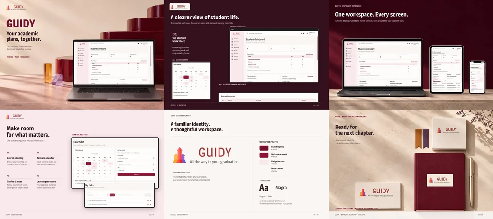

# Guidy Frontend

## Overview

Guidy is a study workspace for course planning, schedules, tasks, notes, grades, and learning resources. Its React interface provides separate workspaces for students, contributors, and administrators, connected to the Guidy API.

## Project Preview



Application preview.

## Key Features

- Course browsing, registration, schedules, and personal grade tracking.
- Calendar events, tasks, notebooks, and role-aware workspace search.
- Learning-resource submissions, review status, and approved downloads.
- Role-specific dashboards, notifications, profiles, and recovery-code password reset.
- Responsive navigation and explicit loading, empty, and error states.

## Live Website & Related Repository

Application: https://guidy-frontend-bice.vercel.app/

Backend repository: https://github.com/mayurbohraa/guidy-backend

## Tech Stack

- **Interface:** React 18, Create React App 5, React Router 6, CSS.
- **Libraries:** Axios, React Calendar, Recharts, React Toastify, Unicons.
- **Checks:** Jest, React Testing Library, ESLint.

## Prerequisites

Node.js and npm, plus a configured Guidy API. Node.js 24 is the runtime used for this documentation verification.

## Installation & Setup

1. Clone and open the frontend:

   ```sh
   git clone https://github.com/mayurbohraa/guidy-frontend.git
   cd guidy-frontend
   ```

2. Install dependencies:

   ```sh
   npm ci
   ```

3. Configure and start the backend using its README. Development requests use `/api/v1` through the configured proxy at `http://localhost:4000`.
4. To use another API, create `.env.local` with `REACT_APP_API_URL` set to its full base URL, including `/api/v1`. This is public build-time configuration. Restart the development server after changes.

## Running Locally

Development, normally at `http://localhost:3000`:

```sh
npm start
```

Create the production output in `build/`:

```sh
npm run build
```

Serve `build/` with a static host that redirects application routes to `index.html`. There is no production-preview script in this repository.

Run tests and lint:

```sh
npm test -- --watchAll=false --runInBand
```

```sh
npm run lint
```

## Project Structure

```text
public/               # HTML, public assets, and README preview
src/
├── Api/              # Axios client and request helpers
├── components/       # Account screens and role workspaces
├── routes/           # Nested dashboard routes
├── service/          # Feature API services
└── assets/           # Styles, images, and branding
package.json          # Dependencies and commands
```
